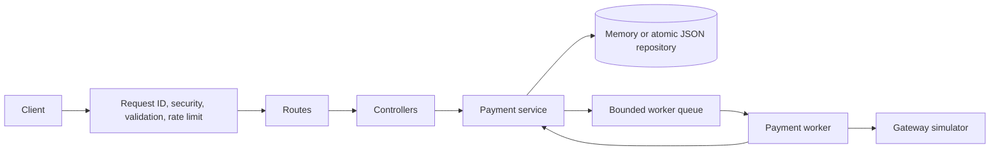

# Payment Processing Simulation

Production-minded Node.js microservice that accepts payments, persists them, and processes them asynchronously through a configurable gateway simulator.

## Overview

The service exposes REST endpoints for creating, retrieving, listing, and updating payment status. Payments are created as `PENDING`, returned immediately with `202 Accepted`, and processed by a bounded background worker.

Interactive API documentation is available at `/docs` after startup.

## Architecture



The code is separated into routes, controllers, services, repositories, workers, middleware, configuration, validation, and utilities.

## Requirements

- Node.js 24+ LTS
- npm

The current project declares `node >=24`. Running under an older Node version may produce an engine warning.

## Setup and run

```bash
npm install
cp .env.example .env
npm run dev
```

Production-style execution:

```bash
npm run build
npm start
```

Default base URL: `http://localhost:3000`  
Swagger UI: `http://localhost:3000/docs`

## Environment variables

| Variable | Default | Purpose |
| --- | --- | --- |
| `NODE_ENV` | `development` | Runtime environment |
| `HOST` | `0.0.0.0` | Listen address |
| `PORT` | `3000` | Listen port |
| `LOG_LEVEL` | `info` | Pino log level |
| `STORAGE_TYPE` | `memory` | `memory` or `json` |
| `DATA_FILE_PATH` | `./payments.json` | JSON repository path |
| `WORKER_CONCURRENCY` | `4` | Concurrent worker jobs |
| `QUEUE_MAX_SIZE` | `1000` | Maximum queued payments |
| `GATEWAY_FAILURE_RATE` | `0.1` | Simulated failure probability |
| `GATEWAY_TIMEOUT_RATE` | `0.2` | Timeout share of failures |
| `GATEWAY_PERMANENT_FAILURE_RATE` | `0.1` | Permanent failure share |
| `GATEWAY_MIN_LATENCY_MS` | `50` | Minimum gateway latency |
| `GATEWAY_MAX_LATENCY_MS` | `500` | Maximum gateway latency |
| `GATEWAY_ATTEMPT_TIMEOUT_MS` | `2000` | Per-attempt timeout |
| `MAX_PROCESSING_ATTEMPTS` | `3` | Maximum attempts per payment |
| `RETRY_BASE_DELAY_MS` | `100` | Initial retry delay |
| `RETRY_MAX_DELAY_MS` | `5000` | Maximum retry delay |
| `SHUTDOWN_TIMEOUT_MS` | `30000` | Worker drain deadline |
| `CORS_ORIGINS` | empty | Comma-separated allowed origins |
| `RATE_LIMIT_WINDOW_MS` | `60000` | Rate-limit window |
| `RATE_LIMIT_MAX` | `100` | Requests per API client per window |
| `TRUST_PROXY` | `false` | Enable only behind a trusted proxy |

## API reference

### Create a payment

`POST /api/v1/payments`

The `Idempotency-Key` header is required. Amounts are integer minor units.

```bash
curl -X POST http://localhost:3000/api/v1/payments \
  -H 'Content-Type: application/json' \
  -H 'Idempotency-Key: order-123' \
  -d '{"amount":1250,"currency":"USD","customerId":"customer_123","description":"Example payment"}'
```

Returns `202` for a new payment and `200` when replaying the same key and payload. Reusing a key with a different payload returns `422`.

### Retrieve a payment

```bash
curl http://localhost:3000/api/v1/payments/<payment-id>
```

### List payments

```bash
curl 'http://localhost:3000/api/v1/payments?status=COMPLETED'
```

### Update status

Supply either `version` in the body or an `If-Match` header.

```bash
curl -X PATCH http://localhost:3000/api/v1/payments/<payment-id>/status \
  -H 'Content-Type: application/json' \
  -d '{"status":"CANCELLED","version":1}'
```

Errors use this shape:

```json
{
  "error": {
    "code": "CONFLICT",
    "message": "Payment version does not match the current resource",
    "requestId": "..."
  }
}
```

## Status state machine

```text
PENDING    -> PROCESSING | CANCELLED
PROCESSING -> COMPLETED | FAILED | CANCELLED
COMPLETED  -> REFUNDED
FAILED     -> terminal
CANCELLED  -> terminal
REFUNDED   -> terminal
```

Invalid transitions return `409 Conflict`. The worker never reprocesses terminal payments.

## Testing and quality checks

```bash
npm test
npm run test:coverage
npm run build
npm run lint
```

The suite covers validation, API success and error paths, both repositories, idempotency races, optimistic concurrency, corrupt JSON, worker retries, timeouts, and dead-letter behavior. Tests inject deterministic randomness, clocks, identifiers, and sleeps where applicable.

## Design decisions and trade-offs

- TypeScript with strict compiler settings keeps domain and repository contracts explicit.
- Joi rejects unknown fields and enforces bounded payment inputs.
- Idempotency is persisted with the payment and protected by serialized repository writes.
- Optimistic version checks prevent lost status updates.
- The worker is process-local and uses bounded concurrency, timeout handling, retryable error classification, exponential backoff, and recovery scans.
- The JSON repository uses write-to-temp-then-rename and serialized writes to reduce partial-write risk.
- Pino logs structured metadata and request IDs; raw malformed payloads and authorization data are not logged.
- The default storage mode is memory for simple local development; JSON is available for restart persistence.

## Failure handling

| Failure | Impact | Mitigation |
| --- | --- | --- |
| Malformed or oversized input | Request cannot be safely parsed | JSON parser limit, malformed JSON handling, Joi validation, unsafe-input rejection |
| Duplicate or concurrent requests | Duplicate payments or inconsistent retries | Required idempotency key, repository mutex, payload comparison |
| Invalid state transition | Invalid domain state | Explicit state machine and `409 Conflict` |
| Concurrent update | Lost status update | Version field or `If-Match`, optimistic conflict detection |
| Gateway timeout | Processing attempt cannot complete | Abortable per-attempt timeout and retry policy |
| Transient gateway failure | Temporary processing failure | Exponential backoff with jitter and max attempts |
| Permanent gateway failure | Payment cannot complete | Immediate `FAILED` dead-letter state with reason |
| Crash mid-processing | Payment may remain unfinished | Startup recovery of `PENDING` and `PROCESSING` records |
| JSON corruption or partial write | Persistence may be unreadable | Fail initialization, temp-file write, atomic rename, serialized writes |
| Disk or I/O error | Payment persistence unavailable | Structured error logging and `503 Service Unavailable` |
| Queue overload | Work cannot be accepted safely | Bounded queue and `503` backpressure response |
| Shutdown during in-flight work | Work could be abandoned | Stop HTTP intake, drain worker until deadline, flush repository |
| Rate abuse | Resource exhaustion | Helmet, CORS policy, body limits, and API rate limiter |

## Security notes

- Helmet sets secure response headers.
- CORS is deny-by-default for configured cross-origin requests.
- Rate limiting is enabled for payment APIs.
- Proxy trust is disabled unless explicitly configured.
- Request IDs aid tracing without exposing stack traces to clients.
- Authorization, cookies, and sensitive headers are redacted from logs.
- Inputs reject prototype-pollution keys and NUL characters; schemas reject unknown payment fields.

## Known limitations and future improvements

- The queue and rate limiter are process-local; Redis or a durable queue is recommended for multiple instances.
- JSON persistence is suitable for the simulation but should be replaced with a transactional database in production.
- There is no authentication or authorization layer yet.
- Metrics, tracing, and an admin view for dead-letter payments should be added.
- Recovery currently scans all recoverable payments at startup rather than using durable job leases.
- Queue and rate limiter are process-local.
- JSON persistence is not suitable for multi-instance production deployment.
- Startup recovery has no distributed job lease, so multiple instances could theoretically process the same payment.
- No authentication, authorization, metrics, or tracing are implemented.
- Shutdown draining is bounded at the worker level but should eventually add explicit connection termination for long-lived HTTP clients.
